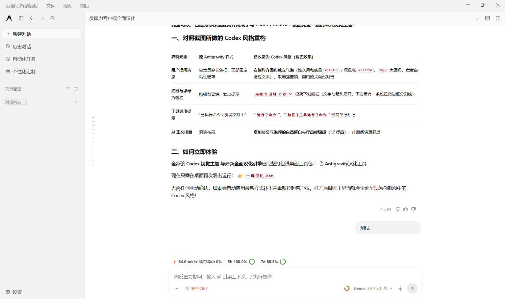
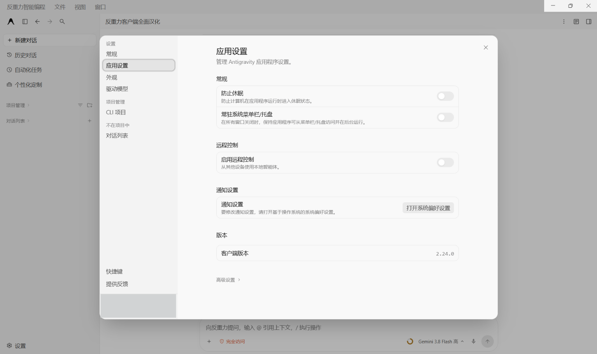

# Antigravity汉化工具

让 Antigravity 的菜单和设置更好读，也让聊天页面更顺手。

这是一个给 **Windows 版 Antigravity** 使用的中文界面工具。下载、解压后，双击“一键汉化”，脚本会检查当前版本、备份文件，再安装补丁并重启客户端。

**聊天界面的布局和交互参考 Codex 页面进行了修改**，包括消息气泡、图片与文字的排列、长文本折叠、过程记录和输入框样式。本项目是社区工具，与 Google、OpenAI 或 Codex 官方没有隶属关系。

## 界面预览

### 聊天页面

### 设置页面

截图来自 Antigravity 2.24.0。内容和数值只是当时的显示效果，实际取决于你的账号、模型和会话。

## 可以做什么

- **界面汉化**：菜单、设置、右键选项、工具提示、用量说明，以及部分内置技能简介。
- **更清爽的聊天页面**：参考 Codex 调整布局，图片和文字分开，长消息可以展开或收起，复制按钮不再压住正文。
- **快速找历史消息**：聊天区旁边有提问刻度，可以预览并跳到之前的提问。
- **查看上下文**：模型选择旁边的圆环显示上一次请求的上下文用量，点击查看详情。
- **查看速度和额度**：显示输出速度、缓存命中率、5 小时和每周剩余额度；额度圆环低于或等于 20% 时变红。
- **更新后重新汉化**：每次都从你电脑上当前安装的版本生成补丁，不会拿旧版客户端文件硬盖到新版上。

速度只显示一个数字：回答生成中显示当前请求的速度，停止后显示这个会话已完成请求的平均速度。缺少实时计数时会按文本估算；没有可用数据时显示横线。用量来自客户端已有数据，工具不会增加额度，也不会改变模型权限。

## 怎么用

### 1. 准备好客户端和 Node.js

- 系统：Windows 10 / 11。
- 先安装并登录 [Antigravity](https://antigravity.google/)，确认聊天页能够正常打开。
- 安装 [Node.js](https://nodejs.org/) **22 或更新版本**。不清楚选哪个时，下载官网的 LTS 版本即可。
- 当前支持默认安装位置：当前用户目录下的 `AppData\Local\Programs\antigravity`。

### 2. 下载并解压

可以到 [Releases](https://github.com/Slowly-77/Antigravity-zh-CN/releases/latest) 下载整理好的 ZIP，也可以点本页上方 **Code → Download ZIP**。

**先解压整个文件夹，不要直接在压缩包里运行，也不要只拿走一个脚本。**

### 3. 双击“一键汉化.bat”

先等正在执行的任务结束，再双击运行。脚本会自动备份、正常关闭客户端、安装并重新打开。成功后窗口会关闭；失败时会保留提示，方便查看原因。

客户端有登录、隐私提示或未保存内容时，先自行处理后再运行。脚本不会强制杀进程。

## 客户端更新后怎么办

重新双击 **一键汉化.bat** 即可。兼容的更新会自动处理。

如果官方大改了页面或内部接口，脚本会停止并提示，等待工具适配。**自动检查不代表所有未来版本都一定能用**，也不会自动翻译未来新增的所有英文。

目前已在 **2.24.0** 上验证安装；同一套核心接口此前也用于 2.23.1。遇到问题时，可以提交 Issue，说明客户端版本和报错文字；截图前记得遮住账号和聊天内容。

## 想撤销怎么办

双击 **一键还原.bat**，恢复为最近一次匹配的安装前状态。备份在本工具的 `backups` 文件夹里，别提前删除。

如果安装前已经有汉化，恢复后仍可能是汉化状态。客户端更新后，旧备份不会强行覆盖新版。还原只处理界面资源，不删除聊天，也不自动删除下面提到的中文偏好。

## 关于中文回复和思考摘要

界面按钮可以直接翻译，但模型生成的内容不一定听话。

工具会在你自己的 `~/.gemini/config/AGENTS.md` 中加入一小段中文交流偏好，保留其他内容，并在修改已有文件前留下备份。它会建议后续回复、可见思考摘要和新会话标题使用中文，**不能保证每个模型每次都遵从，也不会翻译历史消息**。

不想保留这段偏好，可以删除该文件里 `antigravity-zh-display:start` 到 `antigravity-zh-display:end` 的标记段，其他规则保留。

## 隐私和文件

这个仓库只包含汉化源码、测试和上面两张展示图，不附带客户端程序、账号配置、聊天数据库、安装备份或浏览器缓存。

脚本在本机读取客户端界面和会话用量，用于上下文、速度、额度与历史定位。它不包含在线翻译服务，也没有向外上传聊天内容的功能。Antigravity 自身与服务端的正常通信不受本工具控制。

安装产生的资源包和备份只留在使用者自己的电脑上，已加入 Git 忽略规则。

## 想自己改一点

| 文件 | 用途 |
| --- | --- |
| `src/additions.tsv` | 补充英文与中文对照，一行一个词条 |
| `src/dictionary.json` | 基础翻译词库 |
| `src/chat-layout.css` | 聊天页面样式 |
| `src/chat-layout.js` | 长文本、图片和消息布局 |
| `src/context-meter.js` | 上下文、速度、缓存和额度 |
| `src/history-navigation.js` | 历史提问定位 |
| `src/compatibility.json` | 已核对的原生接口指纹 |

修改后重新双击“一键汉化”即可。测试方式见 [开发与测试](docs/DEVELOPMENT.md)。

## 开源说明

项目源码采用 [MIT License](LICENSE)。Antigravity 客户端、Codex 名称和截图中的第三方界面元素属于各自权利人；本仓库不分发官方客户端资源包，也不表示获得了官方背书。
